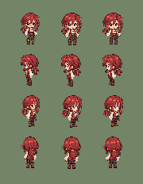
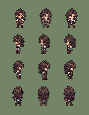
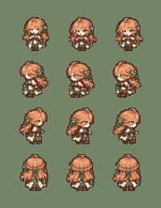
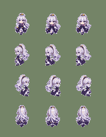

# Four-hero actual PNG 44px visual verdict — 2026-10-30

**ART NO-GO for both resampling candidates. Keep original runtime artwork.** This is a visual review of the *actual committed* hero PNGs from frozen PR #135 HEAD `4a3bff46dc59df2658da9a673718527e8b80724c`, not an approval or a live-game screenshot. PR #98 and `main` remain untouched.

## Source and reproducible comparison contract

Input images (unchanged): `assets/characters/{karen,triton,sophie,margaret}/{id}_walk.png`. Each source is 288×192 RGBA8: 6 frames × 4 directions, 48×48 source cells. For this first visual review, frame 0 from each direction is compared at **44×44 actual output pixels**, same grass background, same top/foot drawing origin. No interpolation, effects, zoom, recolor, or altered poses.

Each image has three columns **left = original nearest-neighbor 48→44**, **middle = face-priority remap from PR #134**, **right = face+footline remap from PR #135**. Four rows are front, left, right, back. The comparison uses the exact `sourceX`, `sourceY`, `sourceYFeet` functions in `js/render/hero_face_priority_44.js`. Original sampling uses `floor((out+0.5)*48/44)` (nearest neighbor at 44px). Background RGB is (116,132,103). PNGs were decoded from the real GitHub blobs and re-encoded, with no synthetic sprite substitutes.

### Karen

### Triton

### Sophie

### Margaret

## Visual judgment

**Reject both resampling candidates for visual adoption** at this stage. The original left column retains a more coherent head-to-body relationship. The middle/right columns visibly emphasize head/hair volume at the expense of torso and garment proportions, most conspicuously for Sophie and Margaret. The face+feet method restores a numerical anchor but compresses 16 original mid-body rows into 12 output rows, so its technical footline PASS is **not** an artistic improvement. Karen and Triton also lose some compact shoulder/body silhouette clarity. The source Margaret remains paler and less sharply separated from her clothing than the V5 mayor/messenger references (see `MARGARET_V3_ACTUAL_SOURCE_VERDICT_20261030.md`), and neither remap fixes her adult face or neck-to-shoulder structure.

**Do not merge, promote, or silently enable either candidate.** Existing opt-in code remains isolated for historical A/B comparison, not as an approved replacement. The default original 48px assets and 44px in-game presentation are unchanged. This decision is a direct pixel-level aesthetic judgment for the displayed four-direction **frame 0** comparisons, not a claim about every walk frame or actual in-game animation.

## Implementation / safety

- Created **four real 180×232 PNG A/B images** from the four current 288×192 GitHub source atlases; no existing image or production file was replaced.
- No runtime code, story, save schema v23, battle balance, buildings, or environment tiles changed.
- PNG generation was executed in a JavaScript isolation environment using actual GitHub PNG bytes and a custom PNG decode/encode pass. Image display was visually reviewed at native pixel size. The file integrity of the resulting committed GitHub blobs should be independently verified after commit.
- **Not executed:** Chromium game scene capture, all 24 walk frames per hero, eight action sheets, all-game regression, V5 NPC in the same *live game* frame.
- No GitHub Actions minutes or paid API used.

## Next art work (not another automatic downsampling algorithm)

Hand-redraw Margaret's **forehead, adult face, long-hair masses, neck-to-shoulder transition, and torso/robe silhouette** on a separate reversible 48px four-direction candidate using the original source as identity reference. Preserve white/silver hair, book, calm personality, adult proportions and distinct body language. Compare original and hand-redraw at native 44px alongside Karen, Triton, Sophie and V5 mayor/messenger; reject if the candidate reads worse. Then complete walk/idle/run/talk/etc. and capture the actual village game scene before approval. Do not switch to buildings before character cohesion is demonstrated.
