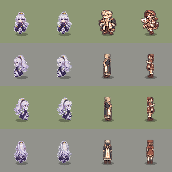

# Margaret V3 — real-source 44px visual verdict (2026-10-30)

**ART NO-GO / DRAFT / no production adoption.** This is a continuation of PR #122 at exact source HEAD `4f35d29c472f77f765a579753d7e9824bef0f303`. It does not modify that frozen branch, PR #98, `main`, authored character PNGs, Save schema 23, game balance, maps or buildings.

## Evidence from the actual committed images

Source: `assets/characters/margaret/margaret_walk.png` (288×192 RGBA; six 48×48 walk frames per direction). Reference: `assets/npc/featured_residents_charm_v5.png` (432×192 indexed PNG). V3 candidate was reconstructed from the committed `js/render/margaret_silver_study.js` V2 color transform and V3 alpha geometry, not from a synthetic test image.



**Columns, left to right:** original Margaret, V3 Margaret, V5 mayor, V5 kingdom messenger. **Rows, top to bottom:** front, left, right, back. Each cell uses a 48px source cropped to a 44px pixel-nearest rendering on the same 72px ground tile, with the same ground contact shadow. Grass and stone backgrounds alternate by row. This is a **static pixel composite**, **not a live Chromium game screenshot**; no claim about actual scene lighting or motion is made.

V3 adds actual opaque silhouette pixels in **all four directions** of the walk sheet: front **157**, left **88**, right **92**, back **182** (total **519** across 24 frames). No direction is a zero-change false positive. All eight actual animation sheets were independently decoded and inspected:

| Pose | Front | Left | Right | Back | Total |
|---|---:|---:|---:|---:|---:|
| walk | 157 | 88 | 92 | 182 | 519 |
| idle | 107 | 55 | 64 | 123 | 349 |
| talk | 105 | 57 | 63 | 123 | 348 |
| run | 155 | 87 | 96 | 182 | 520 |
| laugh | 157 | 85 | 93 | 182 | 517 |
| surprise | 106 | 54 | 63 | 118 | 341 |
| turn | 84 | 48 | 53 | 97 | 282 |
| approach | 110 | 60 | 62 | 122 | 354 |

These counts establish that V3 changes actual alpha geometry, **not** that it improves the art.

## Visual judgment — NO-GO

At actual 44px, V3's crown and outline additions make only a small perceptual difference. Margaret still has a pale, wide hair silhouette, less clearly defined adult face and narrower, visually softer torso than the strong readable shapes of the V5 mayor/messenger. Her head/body balance remains inconsistent with the four-hero style target. **Do not replace the default sprite with V3.** Neither the original nor V3 is hereby approved as final.

Two additional in-memory studies were rejected before branch adoption: a five-value quantized hair pass made the pixel clusters too noisy, while a broad silver-plane pass flattened the hairstyle and still did not improve face readability. These studies were **not** connected to the game or committed as runtime assets. Pixel-change volume was not used as an art score.

## Next implementation gate

1. Stop making marginal color/outline tweaks. Hand-redraw Margaret's **forehead, adult face, distinct long hair masses, neck-to-shoulder transition and robe/torso silhouette** as an independent 48px four-direction candidate, retaining her established white hair, calm expression, vertical color mass and book identity.
2. Create and compare actual source PNGs with the original, Karen/Triton/Sophie and V5 mayor/messenger **at 44px on identical grass/stone scenes**. Reject any candidate that is not visibly better at 1×.
3. Verify all eight animations and ground anchors. Only then offer an opt-in live-game A/B; do not silently replace the default art.
4. After the four protagonists are visually coherent, proceed to other NPC roles, and only then houses/city/fort.

## Reproducible browser check

```bash
python tests/browser_margaret_v3_real_art_e2e_test.py
```

The test loads the **actual** eight PNG animation sheets and **actual** `MargaretSilverStudy.makeCandidate(..., 3)` in Chromium, checks alpha preservation and nonzero silhouette change in all four directions, and writes four 44px gallery screenshots, a 4× front pixel inspection and `actual_source_metrics.json`. The test is **committed but not executed in this session** because a complete private-repository checkout is not available in the execution container. The independent image decoding and static composite above **were** executed. Neither is an 8–12-hour game playthrough or human art approval.

No GitHub Actions minutes or paid API were used.
